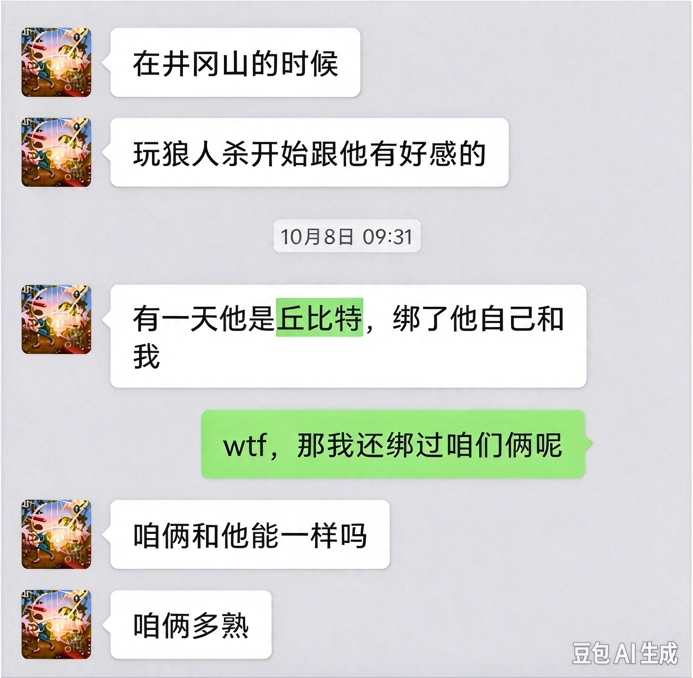

## 社会实践————爱的开端

**京港山** 说起来，还是 张衡 的老家，它没有那么富裕，但是也养不出这么 **龌龊** 的人。

张衡 完全能理解呀，几个人一起 *日出而作、日落而息* ，互生情愫也是人之常情。不过 陆令萱 的理由就耐人寻味了。

*陆令萱 的爱慕*

这是 陆令萱 那一晚上 **为数不多** 赢的一把狼人杀。是的，因为 杨国忠 用着 **丘比特** 角色，把自己和 陆令萱 连在一起，带着 陆令萱 赢了一把，这时候就 **好感度++** 了。
> 被爱神的箭矢射中了呢\~

诶？你能猜出来，狼人杀这个游戏是 **哪一位** 提出来，增进同学友谊的吗？

*王昭君 的无能狂怒*

是的，狼人杀这个提议甚至是 **王昭君** 提出来的。

结果成为了 陆令萱 和 杨国忠 爱情的 **开端** 。

之后 陆令萱 便 **一发不可收拾**

*陆令萱 的爱慕爱慕promax*

## 这份爱意，才刚刚开始

> 当所有人都替你开心，我却才傻傻清醒，原来早已有人为你定做了**嫁衣**。
>
> —— 张远《嘉宾》

