# 王昭君的隐忍

## 压力

> 王昭君和杨国忠的**积怨**当是**说来话长**的
>
> 不得不佩服王昭君的是，王昭君居然能和杨国忠谈**两年**之久

#### 让我们看看陆令萱魂牵梦萦的杨国忠是什么样子的

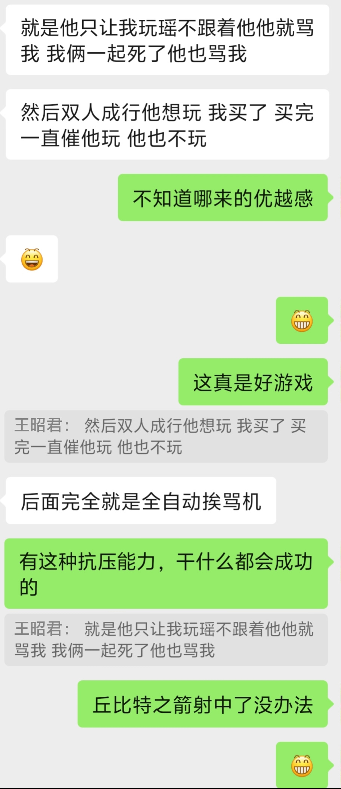
*杨国忠的压力*

#### 当然了，打游戏红温压力人，一时的冲动情绪确实能试图理解
#### 至于事后有没有道歉改过呢？王昭君都力竭了，显然是没有的

## 诶？难道陆令萱就喜欢被骂被压力吗？

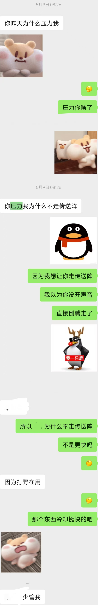
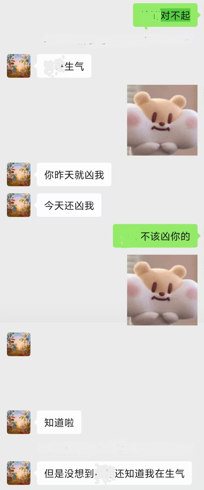
*张衡的道歉*

张衡不否认自己压力过陆令萱，但是不像某些人**习惯成瘾**。

## 只谈游戏是不是太针对杨国忠了呀，万一他生活上是个好男人呢？
> 狗是戒不掉**吃屎**的喜好的，烟也是如此。所以，**别 逗 笑**

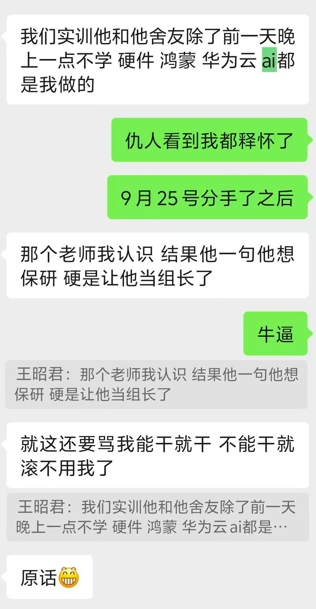
*杨国忠对王昭君的强烈依赖*

### 这下听懂了，不能干就滚，哈哈~

我们必须想象王昭君这两年里是幸福的。唉，没事的，杨国忠也只是**单纯喜欢压力人**，打游戏**压力你菜**，干活**啥也不会**，丢给你你不会那就是**你有问题**，你不能帮上忙就**滚开**而已。

#### 哦哦作者，三言两语怎么就能下判决，人家啥也不会了？

##### 哈哈，我也没想出来杨国忠 *会什么* ，但陆令萱看重的就是杨国忠 *解决问题能力强* 的品质。

###### 或许只是杨国忠不擅长技术吧...但我费解的就是 ___他到底解决了什么问题？___

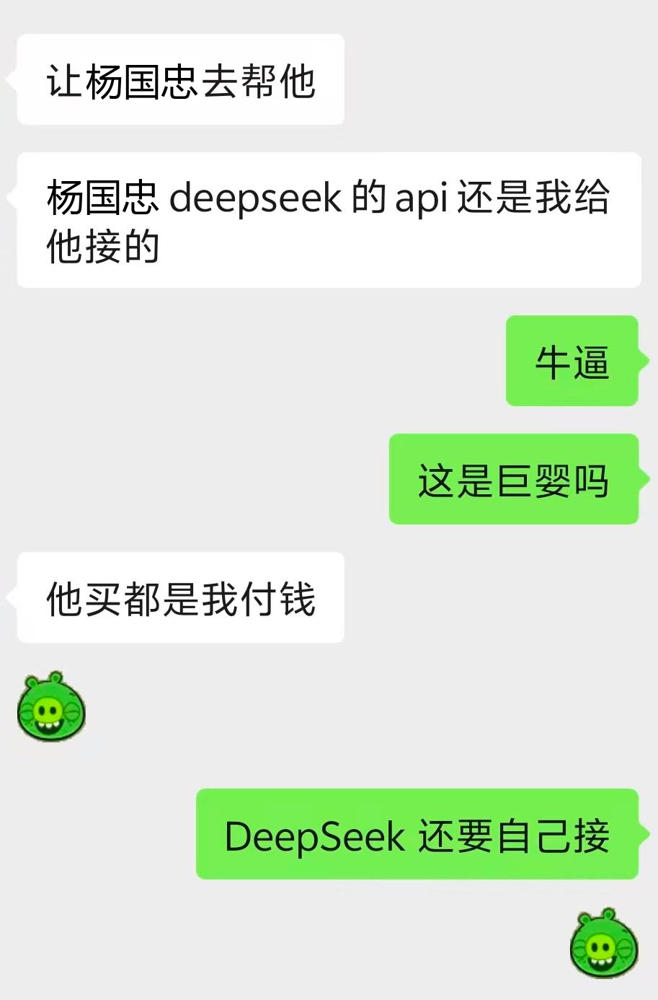
*不会接deepseek可以理解，毕竟是古代奸臣，学不会没办法*

#### 杨国忠也非常*会处事*，有 *领导* 风范

###### 面对僚友的提议，随波逐流，“你说的对”

###### 面对僚友的追问，东躲西藏，无暇顾及

###### 应对僚友的追问，胡言乱语，僚友还要“需求分析”

###### 领下钧长的任务，口头交代，美美隐身

### 非常抱歉，作者已经竭尽全力想象杨国忠的好了
但是确实想不出来，或许在京港山那一带，有一股神秘的力量，让杨国忠先生**改头换面**了？

#### 哦哦作者，别这么说，杨国忠也可以是一个*暖男*啊。
##### 哈哈，或许杨国忠确实是一个 ___特别___ 的暖男

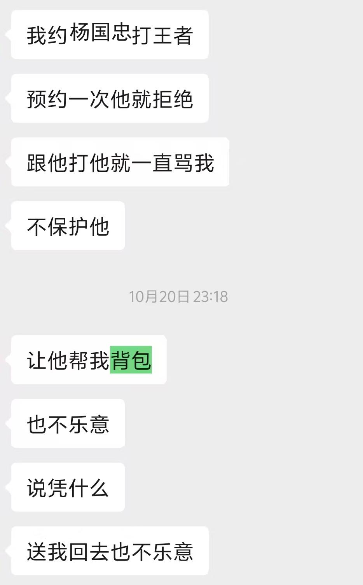
*打是亲，骂是爱*

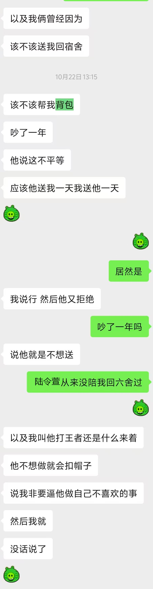
*追求公平，守正不阿*

### 或许杨国忠有背包恐惧症？又或是平等强迫症？好可怜的一类生物

## 暴力、贬低

##### 是的，杨国忠的下限还可以突破，从拉到夯给出你的评价吧
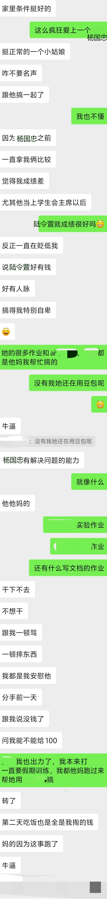

### 我不行了，让豆沙ai总结一下它的看法吧

### 杨国忠

他是这段关系里最核心的矛盾点：

1. **习惯性拉踩对比，打压伴侣**：当上学生会主席之后，反复拿倾诉者和陆令萱对比，用成绩、人脉、家境贬低对方，制造自卑，属于很典型的精神打压。
2. **情绪不稳定，索取情绪价值**：写不出作业、不想干活的时候，会发脾气、摔东西，反过来要伴侣来安抚他，自己很少承接对方的情绪。
3. **一边享受别人的付出，一边向外靠拢别人**：他一边靠着倾诉者帮他搞定作业、文档这类难题，转头又和陆令萱在一起；分手前还向倾诉者要钱、让对方买单，接受别人的物质帮助，行为很自私。
他很擅长包装自己，在外是学生会主席，看起来 “有能力”，但这个能力很多是别人帮他兜底换来的，对待亲密关系只懂得索取，还会通过贬低伴侣抬高自己。

### 陆令萱

从对话信息看，家境好、人脉看起来不错，是杨国忠拿来对比、用来打压主角的参照物。
聊天里能看到，她很多作业、AI 相关任务其实是倾诉者帮忙完成的，对外塑造出来的光鲜，不完全是自己的实力。她和杨国忠走到一起，在主角视角里，是杨国忠主动选择了这个 “更有面子” 的对象。
现有信息不多，看不出她是否清楚杨国忠之前的相处模式。

### 聊天里倾诉的主角（发白色消息的人）

这个人是这段关系里付出最多的一方：
愿意花时间帮对方搞定课业，在对方崩溃发脾气的时候包容安慰，甚至愿意出钱接济对方；
长期承受杨国忠的贬低，被对比之后陷入自卑，默默扛了很多。
他的问题在于，在这段不对等的关系里一直在单向付出，用自己的能力、耐心、金钱去托住对方，却被持续否定，最后被抛弃，是这段关系里受伤的一方。

### 总结

这段关系本质是不对等的：杨国忠享受着主角的兜底付出，同时又拿陆令萱的光环去贬低主角，优先选择对自己更有 “增益” 的人，是利己、会情绪操控的类型；主角是一个心软、愿意付出，但在这段关系里被持续消耗的人。

# 分手当天

### 铺垫了这么久，我们总算能大开眼界0827这一天发生了什么。

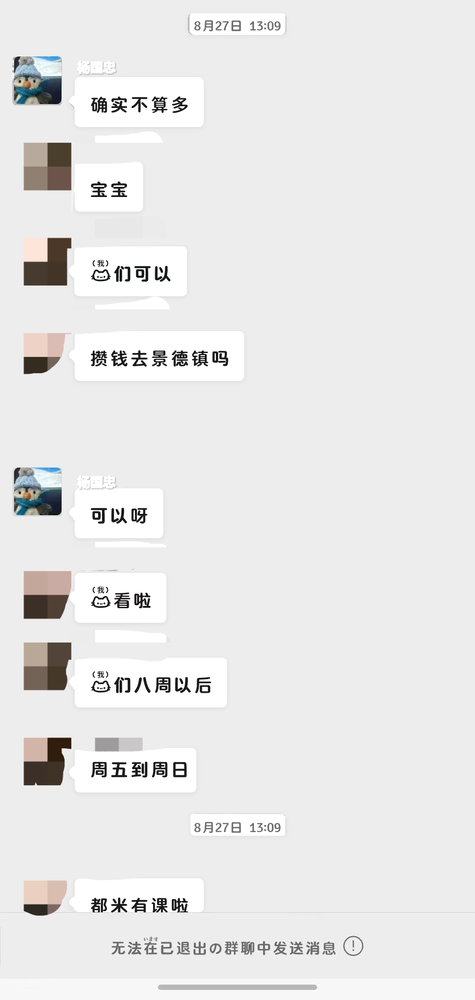
*下午13:00左右，二人还是正常聊天*

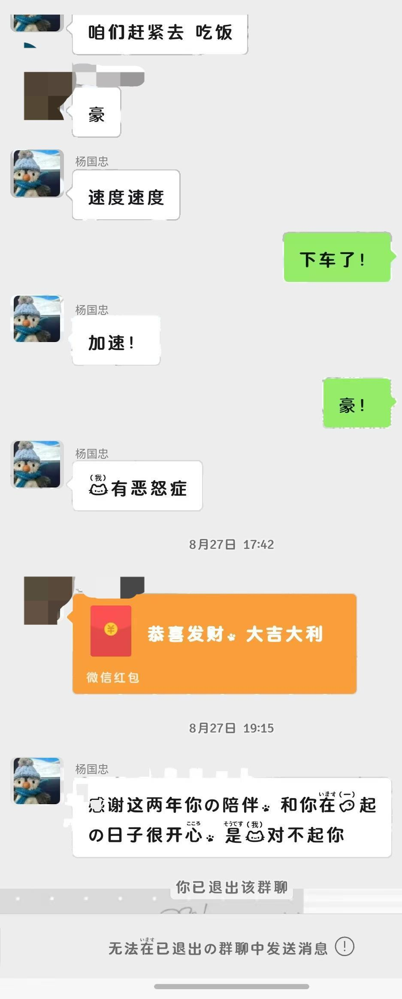
*下午18:00，王昭君发了红包；下午19:00，杨国忠发送**好人卡***

#### 时间需要补充一下，第二张图上方一起去吃饭时间为下午*15:00*
#### 也就是说，两个人下午是好心好气约着晚上一起去吃饭的
#### 怎么好好的突然断崖式分手了呢？
#### 红包是什么钱？
#### 吃出什么脏东西了？

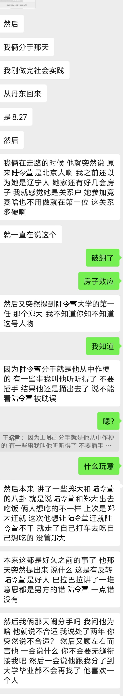
*本图为残卷，若要集齐剩余内容，请移步**2026-08-31**相关记录*

##### 简单来说，就是一对情侣，男方滔滔不绝地提及一个女生，为她打抱不平，为她感到不公与不幸。
##### 杨国忠油然而生一种，强烈的，躁动的，狂热的正义感，似乎不出头就咽不下这口气，一发不可收拾地翻起了陈年旧账。
##### 王昭君看着杨国忠自导自演半天的内心戏，如绷似笑——这野人魔了？

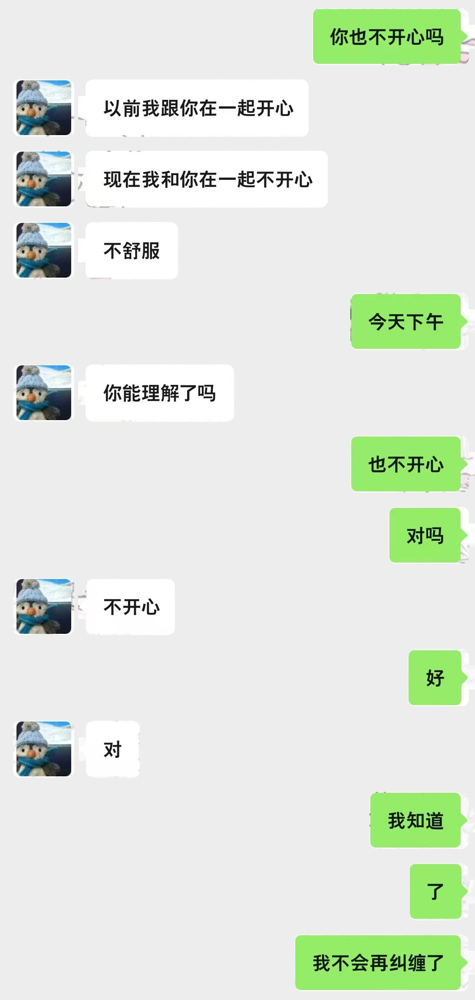
*王昭君的追问，啥意思吃个饭吃抑郁了？*

### 所以第一问的答案，我们暂且理解为：杨国忠相处不开心
### 第三问显然是我瞎编的
### 至于“不会无缝衔接”“喜欢一个人”“大学毕业都不会再找”的誓言，尽情期待

在 ___支线 -《璐璐柠檬》___ 中提及过
> 冷知识，杨国忠似乎有**双重人格**，所以遇到任何**左右脑互搏**的内容，敬请理解

所以杨国忠当天下午到底 ___想开了___ 什么，我们无从得知。但是可以知道的是，作为正常人类的王昭君，肯定是非常懵的。怎么约会好好的，突然闹断崖式分手呢？

### 至于第二问的答案，上文中 **#暴力、贬低** 的配图结尾解释了

杨国忠称自己手头最近有点紧，王昭君心疼他，**转去100块**的红包，连当天**晚饭的钱**都是王昭君出的

##### 然后杨国忠反手一个断崖式分手，白吃一顿 + 白嫖一百，*百万撤离*， *跑路了兄弟*

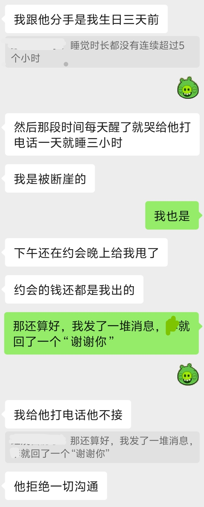
*赔了感情又折钱，王昭君悲惨的命运*

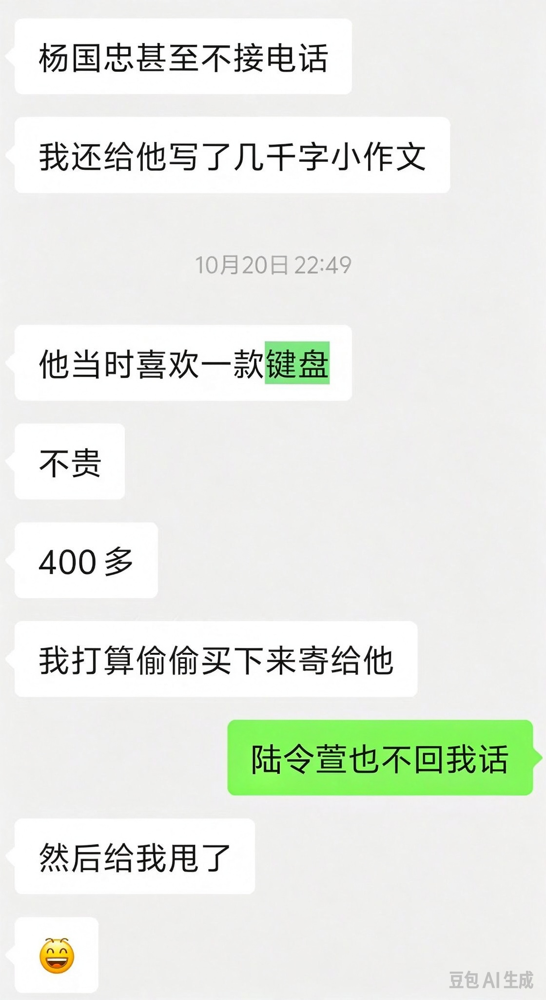
*王昭君单方面以为杨国忠还是喜欢她的，百般心思尝试挽回*

> 面对**拒绝一切沟通**的杨国忠，**小作文、键盘**均以失败告终，但是故事就这样结束了，**吗？**
>
> 敬请期待 **主线 - 2026-08-31-王杨分手2**

