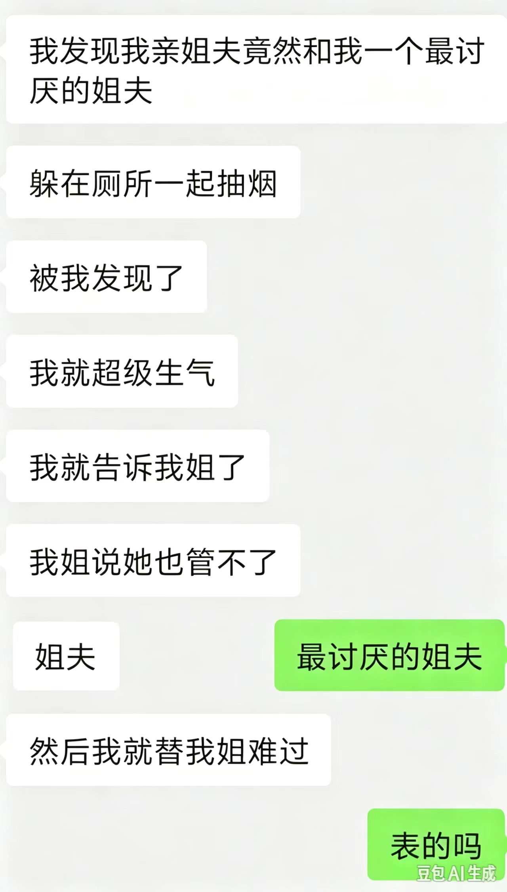
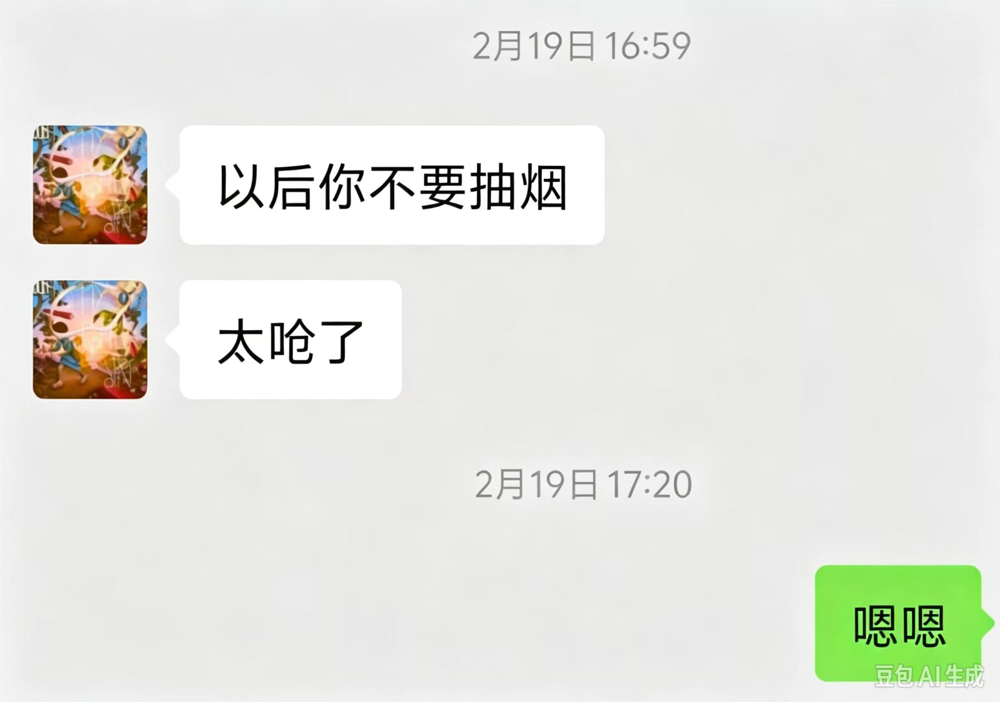
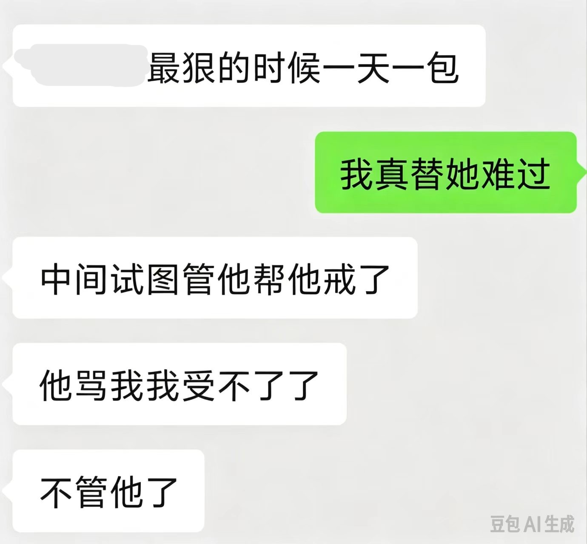

如果 L 不是在 ___梦呓___ 的话，她对**烟**应该是非常抗拒的

*L 对亲姐夫的失望*

*L 对 Z 的劝诫*

## 所以爱上一天一包荷花的男人
## 真的很勇敢

*W 对 Y 的无效劝阻*

### 正是这样的爱情，才让旁人羡煞不已吧。
### 为了真爱，可以改掉自己19年讨厌的习惯，去接纳对方。
### 严于姐夫和前任，宽于不一样的他。❤️

> 戒了烟我不喜欢，没有烟我不习惯

