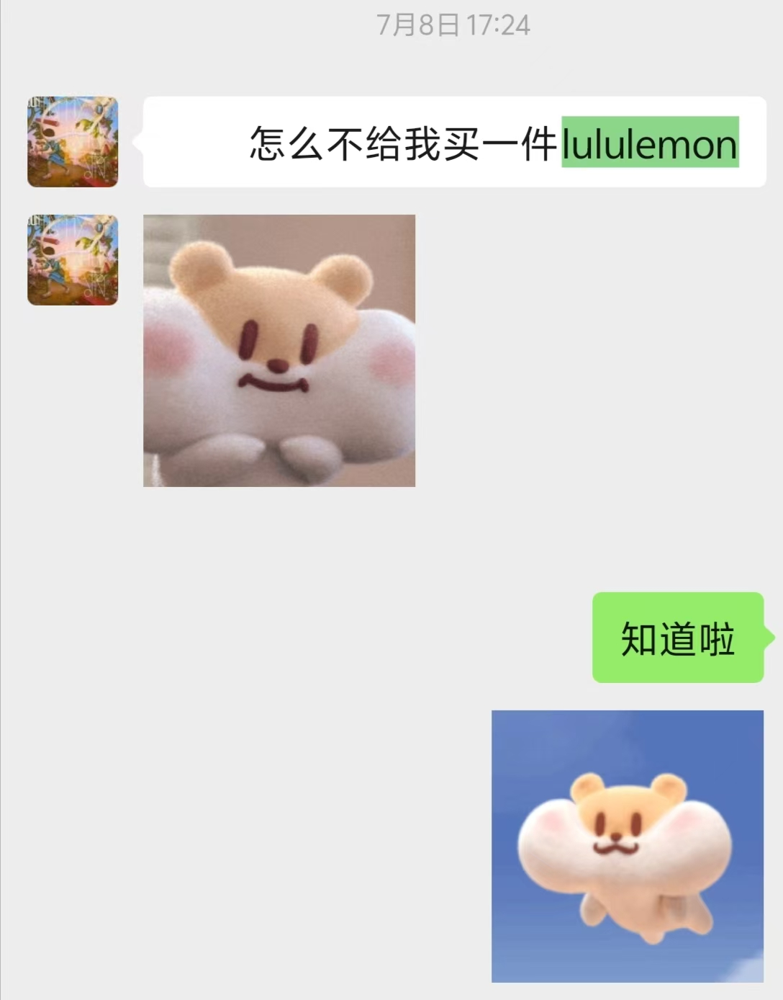
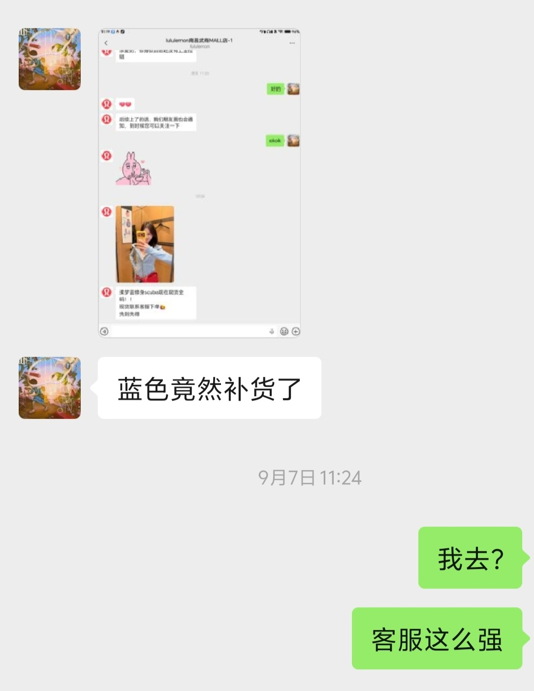
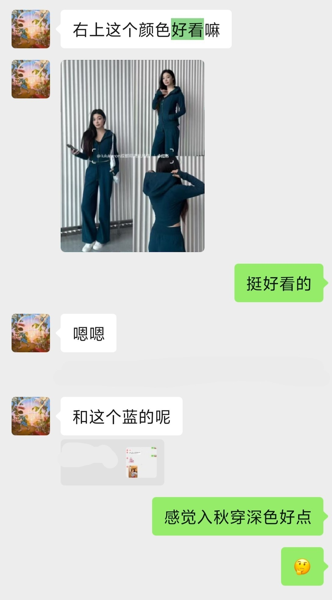
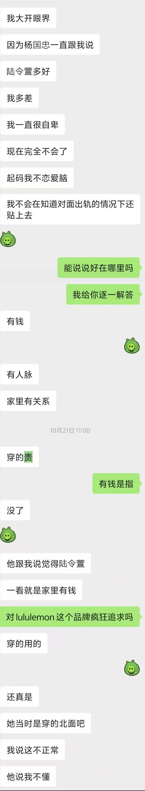

## 陆令萱的狂热追求

**璐璐柠檬** 是高端运动生活品牌之一，陆令萱特别**痴狂**这个品牌。

卫衣、运动服应有尽有，时不时要问问张衡这一件好不好看，那一件合不合适。

陆令萱主动送过张衡一件璐璐柠檬，张衡没有**家缠万贯**，也不是**名门望族**，咬咬牙，也回礼了一件。

出去逛街时，陆令萱也总是留意是否有璐璐柠檬的店铺。

### 什么都是假的，只有男朋友送的璐璐柠檬才是真的
#### 这句话，是陆令萱收到张衡买的璐璐柠檬时，发的朋友圈文案

*陆令萱与张衡的对话*

## 这正中杨国忠下怀

### 毕竟璐璐柠檬是高端品牌，衣服的价格大多在1k上下浮动

所以或许看不出陆令萱是否会穿搭，但是起码能看出她会穿**贵**的
##### 杨国忠：有这好事？

冷知识，杨国忠似乎有**双重人格**，所以遇到任何**左右脑互搏**的内容，敬请理解
> 因为作者也**无法理解**

杨国忠经常拿王昭君与陆令萱进行**踩前碰后**式的比较：

#### 夸赞别的女人，贬低自己的对象

##### 划重点，是在交往的时候，不是分手之后

### 这样或许能解释后续发生的事情了

当杨国忠发现自己 ___费尽心思地，招人厌恶，却无人欣赏___ 时，有一个**陆令萱**的朱脸贴上来了。

自然不必再纠缠于王昭君，一改之前苦苦哀求的模样，大大方方地接纳。

其实苦苦哀求一词**不够准确**，具体的丑态详见主线**2026-08-27**附近记录。

### 毕竟上文提到过，杨国忠是一个左右脑互搏的类人

> 金钱、背景、权力，在渣滓的眼中胜过一切

